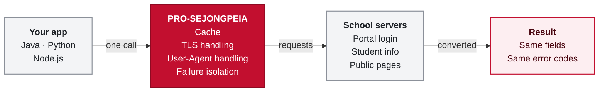
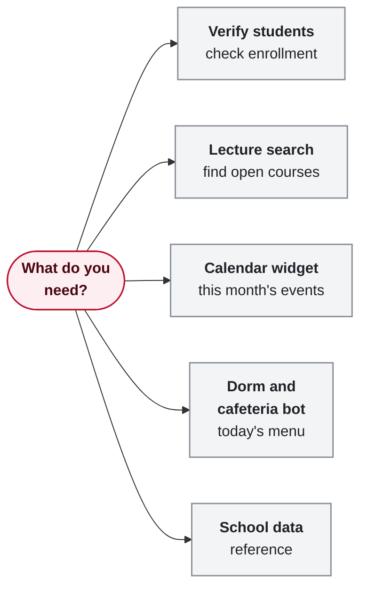

<div align="center">

<div align="right">

[한국어](README.md) · **English**

</div>


<br>

**From student login to departments, lectures, the academic calendar and cafeterias,<br>one call from Java, Python or Node.js.**

Sejong University has no official API, so doing it yourself means solving the portal login and parsing the school's pages.<br>This library has already solved that part.

**[Documentation](https://cassiiopeia.github.io/pro-sejongpeia/en/)** &nbsp;·&nbsp; [Try it in the browser](https://cassiiopeia.github.io/pro-sejongpeia/en/#demo) &nbsp;·&nbsp; [Quick start](https://cassiiopeia.github.io/pro-sejongpeia/en/start/quickstart/) &nbsp;·&nbsp; [School data](https://cassiiopeia.github.io/pro-sejongpeia/en/data/overview/)

</div>

| | Doing it yourself | pro-sejongpeia |
|---|---|---|
| **Portal&nbsp;login** | Handle the legacy TLS cipher, the User-Agent the firewall blocks and SSO cookies on three domains | One line: `authenticate(studentId, password)` |
| **Login&nbsp;result** | A failed login still returns HTTP 200, so you read a value inside a script in the response | Stops at the first failure and tells cases apart by error code such as `AUTHENTICATION_FAILED` |
| **School&nbsp;data** | Parse a different address, HTML or JSON for every page and throttle the load yourself | Same-shaped objects, a 24-hour cache, the last value when the school fails |
| **Three&nbsp;languages** | Implement it separately per language | Same features, same result fields, same error codes |

<sub>How each row was solved is in [What this library does](https://cassiiopeia.github.io/pro-sejongpeia/en/start/introduction/) and [Understand](https://cassiiopeia.github.io/pro-sejongpeia/en/understand/legacy-tls/).</sub>

```bash
pip install pro-sejongpeia      # Python 3.9+
npm install pro-sejongpeia      # Node 18+ (Java: see Try it right now below)
```

<div align="center">

[](https://central.sonatype.com/artifact/kr.suhsaechan/sejongpeia) [](https://pypi.org/project/pro-sejongpeia/) [](https://www.npmjs.com/package/pro-sejongpeia) [](LICENSE) [](https://github.com/Cassiiopeia/pro-sejongpeia/actions/workflows/PROJECT-SEJONG-LIVE-CHECK.yml)

</div>

## At a glance

One call goes through the cache, TLS and User-Agent handling and failure isolation, and the school's response comes back in the same shape.

<!-- diagram:overview:start -->

<!-- diagram:overview:end -->

## What you get

Not just student verification. The public data the school serves without a login comes in the same shape. **Everything works the same in all three languages**; only the naming follows each language's convention (Python uses snake_case).

| | Feature | What you get |
|:-:|---|---|
|  | **[Student verification](https://cassiiopeia.github.io/pro-sejongpeia/en/auth/methods/)** | Confirm a student with the student ID and portal password. Name, major, year, enrollment status, classic-reading certification, contact info. Pick integrated, DHC or SIS |
|  | **[Department and term codes](https://cassiiopeia.github.io/pro-sejongpeia/en/data/codes/)** | Organization categories (undergraduate and graduate), the term list and the full department list |
|  | **[Lectures](https://cassiiopeia.github.io/pro-sejongpeia/en/data/lectures/)** | The whole term or a search by department, course name or instructor, with schedule and room |
|  | **[Curriculum and course overview](https://cassiiopeia.github.io/pro-sejongpeia/en/data/curriculum/)** | Suggested year and semester, credits and the course overview of a department's curriculum |
|  | **[Academic calendar](https://cassiiopeia.github.io/pro-sejongpeia/en/data/calendar/)** | Undergraduate and graduate schedules, plus the per-business allowed periods you see after login (course registration, certificate printing) |
|  | **[Dormitory](https://cassiiopeia.github.io/pro-sejongpeia/en/data/dormitory/)** | Seven days of menus and the notices |
|  | **[Cafeterias](https://cassiiopeia.github.io/pro-sejongpeia/en/data/cafeteria/)** | The list of cafeterias and daily menus with prices |
|  | **[Campus places](https://cassiiopeia.github.io/pro-sejongpeia/en/data/campus-places/)** | Buildings and welfare facilities with name, coordinates and info |
|  | **[Extracurricular events](https://cassiiopeia.github.io/pro-sejongpeia/en/data/extracurricular/)** | Event schedule with category and location |

## Where to start

Pick the page to read by what you need.

<!-- diagram:choose:start -->

<!-- diagram:choose:end -->

[Verify students](https://cassiiopeia.github.io/pro-sejongpeia/en/guides/student-verification/) · [Department and lecture search](https://cassiiopeia.github.io/pro-sejongpeia/en/guides/department-lecture-search/) · [Academic calendar widget](https://cassiiopeia.github.io/pro-sejongpeia/en/guides/academic-calendar/) · [Dormitory and cafeteria bot](https://cassiiopeia.github.io/pro-sejongpeia/en/guides/dormitory-cafeteria-bot/) · [School data reference](https://cassiiopeia.github.io/pro-sejongpeia/en/data/overview/). Every example comes in all three languages ([Integration examples](docs/INTEGRATION_EXAMPLES.en.md)).

## Try it right now

No student ID or password needed. This fetches the department list and the open lectures of the Software department (3220). All three languages make the same call and return the same result.

**Python** · `pip install pro-sejongpeia`

```python
from sejongpeia import SejongPublicData

public_data = SejongPublicData()
departments = public_data.departments("20", "2026", "20")
lectures = public_data.lectures("20", "2026", "20", department_code="3220")
print(len(departments), lectures[0].name)
```

**Node.js** · `npm install pro-sejongpeia`

```js
import { SejongPublicData } from 'pro-sejongpeia';

const publicData = new SejongPublicData();
const term = { categoryCode: '20', year: '2026', semesterCode: '20' };
const departments = await publicData.departments(term);
const lectures = await publicData.lectures({ ...term, departmentCode: '3220' });
console.log(departments.length, lectures[0].name);
```

**Java / Spring Boot** · `implementation "kr.suhsaechan:sejongpeia:<version>"` ([check the latest version](https://central.sonatype.com/artifact/kr.suhsaechan/sejongpeia), Java 17+, Maven Central)

```java
SejongPublicData publicData = new SejongPublicData();   // inject as a bean in Spring
List<Department> departments = publicData.departments("20", "2026", "20");
List<Lecture> lectures = publicData.lectures("20", "2026", "20", "3220", "", "");
System.out.println(departments.size() + " " + lectures.get(0).getName());
```

Example output (Python).

<p align="center">
  
</p>

### Student login is one line too

```python
result = authenticate("21011234", "password")              # Python
print(result.name, result.major, result.grade)
```

```js
const result = await authenticate('21011234', 'password');   // Node.js
console.log(result.name, result.major, result.grade);
```

```java
SejongAuthResult result = sejongAuthEngine.authenticate(studentId, password);   // Java, Spring Boot bean
System.out.println(result.getName() + " " + result.getMajor() + " " + result.getGrade());
```

> [!WARNING]
> The portal locks an account after several wrong passwords. The library never retries a rejected login, but if anyone can type a student ID into your service, **limit failed attempts per student ID yourself**. A locked account is only unlocked by [resetting the password at the portal](https://portal.sejong.ac.kr/jsp/inquiry/pwinquiry.jsp).

You can also try student login in the browser first.

<p align="center">
  <a href="https://cassiiopeia.github.io/pro-sejongpeia/en/#demo">
    
  </a>
  <br>
  <sub>The live demo on the introduction page (click to try). These are real authentication results; only the personal-data cells were replaced with sample values.</sub>
</p>

Error handling, Spring setup and plain-Java usage are on the [Quick start page](https://cassiiopeia.github.io/pro-sejongpeia/en/start/quickstart/) with tabs for all three languages.

## Why this library

Every promise has proof you can check in the code or the tests.

| Promise | Proof | Details |
|---|---|---|
|  **Fast&nbsp;and&nbsp;light** | Zero dependencies (Python, Node). The department list and one department's lectures take about 0.1 s; the integrated login takes 0.6 to 0.8 s with one sign-in (median of 5) | [What it does](https://cassiiopeia.github.io/pro-sejongpeia/en/start/introduction/) |
|  **Gentle&nbsp;on&nbsp;requests** | 24-hour cache, simultaneous calls with the same arguments share one request, a failure is remembered for 60 seconds | [Cache and failure isolation](https://cassiiopeia.github.io/pro-sejongpeia/en/understand/failure-isolation-cache/) |
|  **Safe** | The password is never stored or put into error messages. SIS extra fields always exclude session values, client IP, resident number, bank account and similar | [Login verdict](https://cassiiopeia.github.io/pro-sejongpeia/en/understand/login-verdict/) |
|  **Trustworthy** | A real portal login check every day at 09:00 KST; values shared by all three languages live in [spec/contract.json](spec/contract.json) | [Daily check](https://cassiiopeia.github.io/pro-sejongpeia/en/understand/daily-live-check/) |

## When it does not fit

> [!IMPORTANT]
> If any of these applies, read this before adopting the library.

- **You need an API the school guarantees.** It follows the unofficial addresses the school's web pages use, not a documented API. When the school changes them it can stop working; it is checked daily and fixed through an issue, but no fix date is promised.
- **You need backward compatibility.** Breaking changes can happen even within the same `1.x`, so pin the version ([API stability](docs/API_STABILITY.en.md)).
- **You want to call it from a browser or an app.** The password would be exposed to third-party code, so call it from a server only.
- **You need live values.** Public data is cached for 24 hours by default. When the school fails it returns the last value or an empty list instead of throwing, so an empty list cannot tell "no data" from "a problem on the school side".
- **You want the school's values processed for you.** They are the school's own strings, with no code table or name mapping.

This is not an official Sejong University library. It is a personal open-source project by a Sejong student and is not affiliated with the university.

## Learn more

The details live on the documentation site and are not repeated here.

| What you want | Where it is |
|---|---|
| Install to first call, Spring setup | [Quick start](https://cassiiopeia.github.io/pro-sejongpeia/en/start/quickstart/) |
| Authentication methods, result fields, error codes, settings | [Authentication reference](https://cassiiopeia.github.io/pro-sejongpeia/en/auth/methods/) ([result fields](https://cassiiopeia.github.io/pro-sejongpeia/en/auth/result-fields/), [error codes](https://cassiiopeia.github.io/pro-sejongpeia/en/auth/error-codes/), [settings](https://cassiiopeia.github.io/pro-sejongpeia/en/auth/configuration/)) |
| Request and response shape per method | [School data reference](https://cassiiopeia.github.io/pro-sejongpeia/en/data/overview/) |
| How the portal blocks you and how it was solved | [Understand](https://cassiiopeia.github.io/pro-sejongpeia/en/understand/legacy-tls/) ([SSO flow](https://cassiiopeia.github.io/pro-sejongpeia/en/understand/sso-flow/)), login flows: [DHC](docs/DHC_LOGIN_FLOW.en.md), [SIS](docs/SIS_LOGIN_FLOW.en.md) |
| Contracts and result schema | [spec/PUBLIC_DATA.md](spec/PUBLIC_DATA.md), [spec/RESULT_SCHEMA.md](spec/RESULT_SCHEMA.md), [spec/PORTAL_FLOW.md](spec/PORTAL_FLOW.md) |
| Integration examples, API stability | [Integration examples](docs/INTEGRATION_EXAMPLES.en.md), [API stability policy](docs/API_STABILITY.en.md) |
| Using it with coding agents | [Agent guide](https://cassiiopeia.github.io/pro-sejongpeia/en/guides/agents/) ([llms.txt](https://cassiiopeia.github.io/pro-sejongpeia/llms.txt), [api.json](https://cassiiopeia.github.io/pro-sejongpeia/api.json)); agents contributing here read [AGENTS.md](AGENTS.md) |

## FAQ

<details>
<summary><b>Authentication suddenly fails / my portal account got locked</b></summary>

Try the [demo](https://cassiiopeia.github.io/pro-sejongpeia/en/#demo) first. If the demo also fails, the portal has probably changed: please open an [issue](https://github.com/Cassiiopeia/pro-sejongpeia/issues) with the error code.
`ACCOUNT_LOCKED` means the portal locked the account: reset the password at <https://portal.sejong.ac.kr/jsp/inquiry/pwinquiry.jsp> (identity verification required). Waiting does not unlock it.
</details>

More questions are answered in the [site FAQ](https://cassiiopeia.github.io/pro-sejongpeia/en/faq/).

## Contributing

Bug reports, portal-change fixes and docs improvements are all welcome. A portal change is fixed in all three languages in one PR. See [CONTRIBUTING.en.md](CONTRIBUTING.en.md). To add a new school data source, see [Add a data source](https://cassiiopeia.github.io/pro-sejongpeia/en/contribute/add-data-source/), for the layout [Repository structure](https://cassiiopeia.github.io/pro-sejongpeia/en/contribute/structure/), and for issues and PRs [Issues and PRs](https://cassiiopeia.github.io/pro-sejongpeia/en/contribute/issues-and-prs/).
Report security issues privately as described in [SECURITY.md](SECURITY.md).

If this library saved you time, a GitHub Star helps other Sejong developers find it.

## License

[MIT](LICENSE) © 2025 Suh Saechan

---

<sub>This project is not an official product of Sejong University and is not affiliated with it. The Sejong University seal belongs to Sejong University.</sub>
