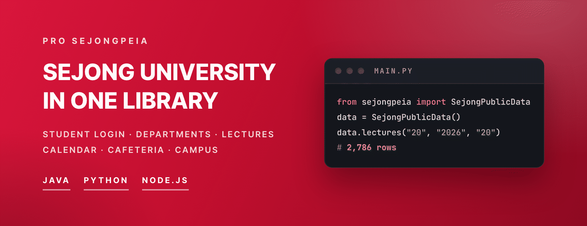

<div align="center">




**Everything you need to build on Sejong University, in one library.**
From student login to departments, lectures, the academic calendar and cafeterias, one call from Java, Python or Node.js.
Fast and light, gentle on requests, never stores a password, and checked against the real portal every day.

<sub>세종대 로그인 API · 세종대학교 포털 인증 · 학번 인증 라이브러리 (Java · Python · Node)</sub>

[Site](https://cassiiopeia.github.io/pro-sejongpeia/) · [Try it in the browser](https://cassiiopeia.github.io/pro-sejongpeia/#demo) · [What you get](#what-you-get) · [Try it now](#try-it-now) · [Docs](#more-integration-examples-and-api-stability) · [한국어](README.md) | English

[](https://central.sonatype.com/artifact/kr.suhsaechan/sejongpeia)
[](https://pypi.org/project/pro-sejongpeia/)
[](https://www.npmjs.com/package/pro-sejongpeia)
[](LICENSE)
[](https://github.com/Cassiiopeia/pro-sejongpeia/actions/workflows/PROJECT-SEJONG-LIVE-CHECK.yml)

</div>

---

## What you get

Not just student verification. The public data the school serves without a login comes in the same shape, 15 kinds in all.

| | Feature | What you get |
|:-:|---|---|
| 🔐 | **Student verification** | Confirm a student with the student ID and portal password. Name, major, year, enrollment status, classic-reading certification, email and phone, and 11 school codes such as the department code. Pick integrated, DHC or SIS |
| 🏫 | **Department and term codes** | 22 organization categories (undergraduate and graduate), the term list and the department list (**103** undergraduate departments) |
| 📚 | **Lectures** | The whole term (**2,786 rows** for undergraduate) or a search by department, course name or instructor, with schedule and room |
| 🎓 | **Curriculum and course overview** | Suggested year and semester, credits and the course overview of a department's curriculum |
| 📅 | **Academic calendar** | Undergraduate and graduate schedules, plus the per-business allowed periods (course registration, certificate printing) you see after login |
| 🛏️ | **Dormitory** | Seven days of menus and the notices |
| 🍚 | **Cafeterias** | The list of **5** cafeterias and daily menus with prices |
| 📍 | **Campus places** | **60** buildings and welfare facilities with name, coordinates and info |
| 🎉 | **Extracurricular events** | Event schedule with category and location |

## Why this library

Four promises, each with proof you can check in the code or the tests.

### ⚡ Fast and light

- **Zero dependencies** (Python, Node): standard library only (`dependencies = []`, `"dependencies": {}`).
- **Measured**: department list about 0.12 s, one department's lectures 0.06 s, the whole term's 2,786 lectures (2.4 MB) 0.9 s. Cached answers take microseconds (Python, Seoul, median of 5 fresh clients; most of the time is the school server's own response).
- **One login**: the integrated call signs in to the portal once and reads DHC and SIS with the same session. Java 0.57 s, Python 0.76 s, Node 0.69 s (median of 5).

### 🧠 Gentle on requests

- Results are cached in memory for **24 hours**, and **simultaneous calls with the same arguments share one request**. The cache holds at most 500 entries (default) and evicts the oldest first.
- A call sends one request. The only exception is the cafeteria list, which sends one per number in a range (10 by default), **one after the other**, per refresh.
- A failed call is **remembered for 60 seconds** so the school's servers are not hammered. Proof: the cache section of [spec/PUBLIC_DATA.md](spec/PUBLIC_DATA.md).

### 🔒 Safe

- **The password is never stored.** It is only used for the portal login request and never put into error messages (test `test_error_message_never_contains_password`).
- **Stops at the first failure.** A wrong password ends with `AUTHENTICATION_FAILED` and no retry, so the account is not locked by the library, and a locked account is reported as `ACCOUNT_LOCKED`.
- The SIS extra fields (`extra`) **always exclude** session values, client IP, account state, resident number, bank account, address and staff names, and server-internal error details are never returned.
- A failing school server does not shake your app: public data returns the last cached value or an empty list instead of throwing.

### ✅ Trustworthy

- **Checked against the real portal every day**: at 09:00 KST all three languages sign in to the live portal, and a failure opens an issue automatically (see the badge above).
- **Same results in three languages**: shared values live in [spec/contract.json](spec/contract.json), and each language's tests fail when they drift.
- **Method list drift check**: CI verifies that the 19 public methods match across [spec/api-index.json](spec/api-index.json), the three sources and the docs, and the shape of the school's responses is checked daily without an account.

The hard parts of doing it yourself (the one cipher the portal accepts, firewall User-Agents, SSO cookies across three domains, verdicts hidden in 200 responses) are already solved. See the [project site](https://cassiiopeia.github.io/pro-sejongpeia/) for details.

## Features

**Everything is supported in all three languages**, with the same features and the same result shape. Only the naming follows each language's convention (snake_case in Python).

| Feature | Java | Python | Node |
|---|:-:|:-:|:-:|
| **Student verification**, 4: integrated · DHC · SIS · SIS business periods | ✅ | ✅ | ✅ |
| **Codes and lectures**, 7: categories · terms · departments · lectures · course types · selective domains · curriculum | ✅ | ✅ | ✅ |
| **Schedule and campus life**, 8: academic calendar (undergrad, graduate) · dormitory menu and notices · cafeteria list and menu · campus places · extracurricular events | ✅ | ✅ | ✅ |
| Raw response, SIS codes and `extra` options | ✅ | ✅ | ✅ |

All method names (per language, including the Java raw-response variants) are listed in [Authentication methods](https://cassiiopeia.github.io/pro-sejongpeia/en/auth/methods/) and [School data: common rules](https://cassiiopeia.github.io/pro-sejongpeia/en/data/overview/).

- **Integrated** returns student info + classic reading + contact, **DHC** student info + classic reading, **SIS** student info + contact.
- SIS business periods are not the public academic calendar (`calendar`): they are the per-business allowed periods of the student's own SIS screen. [SIS business periods](https://cassiiopeia.github.io/pro-sejongpeia/en/auth/business-periods/)
- The public-data contract is [spec/PUBLIC_DATA.md](spec/PUBLIC_DATA.md).

## Try it now

No student ID, no password. This fetches the department list and the lectures of the Software department (3220). Same call and same result in all three languages.

**Python** · `pip install pro-sejongpeia`

```python
from sejongpeia import SejongPublicData

public_data = SejongPublicData()
departments = public_data.departments("20", "2026", "20")
lectures = public_data.lectures("20", "2026", "20", department_code="3220")
print(len(departments), lectures[0].name)
```

**Node.js** · `npm install pro-sejongpeia`

```js
import { SejongPublicData } from 'pro-sejongpeia';

const publicData = new SejongPublicData();
const term = { categoryCode: '20', year: '2026', semesterCode: '20' };
const departments = await publicData.departments(term);
const lectures = await publicData.lectures({ ...term, departmentCode: '3220' });
console.log(departments.length, lectures[0].name);
```

**Java / Spring Boot** · `implementation "kr.suhsaechan:sejongpeia:<version>"` ([check the latest version](https://central.sonatype.com/artifact/kr.suhsaechan/sejongpeia))

```java
SejongPublicData publicData = new SejongPublicData();   // a bean in Spring
List<Department> departments = publicData.departments("20", "2026", "20");
List<Lecture> lectures = publicData.lectures("20", "2026", "20", "3220", "", "");
System.out.println(departments.size() + " " + lectures.get(0).getName());
```

The output (Python, 3 calls to the school servers in 0.3 s). The school data itself is Korean.

<p align="center">
  
</p>

### Student verification in one line

```python
result = authenticate("21011234", "password")             # Python
print(result.name, result.major, result.grade)
```

```js
const result = await authenticate('21011234', 'password');   // Node.js
console.log(result.name, result.major, result.grade);
```

```java
SejongAuthResult result = sejongAuthEngine.authenticate(studentId, password);   // Java, a Spring Boot bean
System.out.println(result.getName() + " " + result.getMajor() + " " + result.getGrade());
```

Error handling and Spring setup are in the [quick start](#quick-start-java--spring-boot) below. Student verification can also be tried in the browser first.

<p align="center">
  <a href="https://cassiiopeia.github.io/pro-sejongpeia/#demo">
    
  </a>
  <br>
  <sub>Live demo on the project page (click to try). A real authentication result with personal fields replaced by sample values.</sub>
</p>

## Use cases

**Verifying Sejong students** when they join a club or student council, checking major or year for campus events, classic-reading progress helpers, department and lecture search, academic calendar widgets, dormitory and cafeteria bots ([integration examples](docs/INTEGRATION_EXAMPLES.en.md)).

## Quick start: Java / Spring Boot

[](https://central.sonatype.com/artifact/kr.suhsaechan/sejongpeia)

Published to **Maven Central** (no extra repository needed). Java 17+, Spring Boot 3.x. Spring Boot auto-configuration registers the `SuhSejongAuthEngine` and `SejongPublicData` beans.

```groovy
dependencies {
    implementation "kr.suhsaechan:sejongpeia:<version>"
}
```

```xml
<dependency>
    <groupId>kr.suhsaechan</groupId>
    <artifactId>sejongpeia</artifactId>
    <version><!-- version --></version>
</dependency>
```

Put the latest version in `<version>`. Check it in the latest-version heading at the top or the [Maven Central artifact page](https://central.sonatype.com/artifact/kr.suhsaechan/sejongpeia); all versions are listed in the [repository index](https://repo1.maven.org/maven2/kr/suhsaechan/sejongpeia/).

```java
@RestController
@RequiredArgsConstructor
public class AuthController {

    private final SuhSejongAuthEngine sejongAuthEngine;   // kr.suhsaechan.sejongpeia.auth.service

    @PostMapping("/auth/sejong")
    public SejongAuthResult authenticate(@RequestParam String studentId,
                                         @RequestParam String password) {
        return sejongAuthEngine.authenticate(studentId, password);
    }
}
```

Plain Java without Spring: call `SejongTlsSupport.ensureLegacyCipherEnabled()` first thing in `main()`. The code that wires the objects is in [Configuration](https://cassiiopeia.github.io/pro-sejongpeia/en/auth/configuration/), and reading the classic-reading status is in [Result fields](https://cassiiopeia.github.io/pro-sejongpeia/en/auth/result-fields/).

## Quick start: Python · Node.js

Python 3.9+ or Node 18+ (zero dependencies, TypeScript types, ESM and CommonJS, server-side only). Branch on the error `code`, not on the message.

```python
from sejongpeia import authenticate, SejongAuthError, ErrorCode

try:
    result = authenticate("21011234", "password")
except SejongAuthError as error:
    if error.code == ErrorCode.AUTHENTICATION_FAILED:
        print("Wrong student ID or password")
    elif error.code == ErrorCode.ACCOUNT_LOCKED:
        print("Portal account locked: reset the password on the portal")
```

```js
import { authenticate, SejongAuthError, ErrorCode } from 'pro-sejongpeia';

try {
  const result = await authenticate('21011234', 'password');
} catch (error) {
  if (error instanceof SejongAuthError && error.code === ErrorCode.AUTHENTICATION_FAILED) console.log('Wrong student ID or password');
  else if (error instanceof SejongAuthError && error.code === ErrorCode.ACCOUNT_LOCKED) console.log('Portal account locked');
}
```

## School data without login

For the method list see [Features](#features) above, and for the first call see [Try it now](#try-it-now). Here is an example that continues from a lecture to its curriculum (Node and Java use the same method names in camelCase).

```python
from sejongpeia import SejongPublicData

public_data = SejongPublicData()
departments = public_data.departments("20", "2026", "20")          # undergraduate, term values are the school's
lectures = public_data.lectures("20", "2026", "20", department_code=departments[0].code)
# the course overview and suggested year/semester in that department's curriculum (empty list if not part of it)
courses = public_data.curriculum_courses(lectures[0].department_code, lectures[0].course_number)
```

- **Raw school values.** No code tables or name mappings are baked in, so renamed departments need no code change, and school fields that are not mapped land in `extra`.
- On failure you get the last cached value or an empty list, not an exception (only invalid input raises). Please be gentle with the school's servers.

- With department, course name and instructor all empty, the lecture search returns the whole term in one call (2,786 undergraduate rows and 2.4 MB, so prefer one department at a time when you can). [Lectures](https://cassiiopeia.github.io/pro-sejongpeia/en/data/lectures/)
- `cafeteria_places` is built from the menu answers because the school has no list endpoint, so a cafeteria with no menu that day can be missing. [Cafeterias](https://cassiiopeia.github.io/pro-sejongpeia/en/data/cafeteria/)

## Result fields

Names are Java / Node; Python uses snake_case. Common fields (`studentId`, `name`, `major`, `grade`, `status`), classic reading, the SIS contact and 11 school codes, and the optional `extra` and raw response are in the [result fields table](https://cassiiopeia.github.io/pro-sejongpeia/en/auth/result-fields/) and [spec/RESULT_SCHEMA.md](spec/RESULT_SCHEMA.md). `extra` and the raw response can contain session values and a client IP, so never pass them to an external client as-is.

## Error codes

Every language raises one error type with a `code`. The meaning of all 10 codes (`AUTHENTICATION_FAILED`, `ACCOUNT_LOCKED`, `ACCOUNT_UNAVAILABLE`, `INVALID_INPUT`, `CONNECTION_FAILED` and more) is in [Error codes](https://cassiiopeia.github.io/pro-sejongpeia/en/auth/error-codes/).

> **Account lock.** The portal locks an account after repeated wrong passwords, and the library never retries a rejected login. Unlocking needs a password reset at <https://portal.sejong.ac.kr/jsp/inquiry/pwinquiry.jsp>. If your service lets anyone type a student ID, limit failed attempts per student ID.

## Configuration

All optional. Defaults: 10 second timeout, 3 login retries, certificate verification on.

| Java (`application.yml`) | Python | Node |
|---|---|---|
| `sejongpeia.timeout-seconds: 10` | `SejongAuthClient(timeout_seconds=10)` | `new SejongAuthClient({ timeoutSeconds: 10 })` |
| `sejongpeia.max-retry: 3` | `max_retry=3` | `maxRetry: 3` |
| `sejongpeia.ssl-verification: true` | `ssl_verification=True` | `sslVerification: true` |

Because of the portal's legacy cipher, Java changes the TLS setting of the whole JVM. Spring Boot does this automatically; otherwise call `SejongTlsSupport.ensureLegacyCipherEnabled()` first thing in `main()`. Details are in [Legacy TLS](https://cassiiopeia.github.io/pro-sejongpeia/en/understand/legacy-tls/); the portal flow is in [spec/PORTAL_FLOW.md](spec/PORTAL_FLOW.md), the [DHC login flow](docs/DHC_LOGIN_FLOW.en.md) and the [SIS login flow](docs/SIS_LOGIN_FLOW.en.md).

## More: integration examples and API stability

- [Integration examples](docs/INTEGRATION_EXAMPLES.en.md): student verification (club sign-up), department and lecture search, an academic calendar widget and a dormitory/cafeteria bot in Java, Python and Node.
- [API stability policy](docs/API_STABILITY.en.md): what is public API and what is internal, and the version rule. **Backward compatibility is not guaranteed, so pin the version.**
- [Using with coding agents](https://cassiiopeia.github.io/pro-sejongpeia/en/guides/agents/): [llms.txt](https://cassiiopeia.github.io/pro-sejongpeia/llms.txt), [api.json](https://cassiiopeia.github.io/pro-sejongpeia/api.json) and prompt examples for agents such as Claude Code, Cursor and Codex. An agent contributing to this repository reads [AGENTS.md](AGENTS.md).

## FAQ

<details>
<summary><b>Is this an official Sejong University library?</b></summary>

No. It is a personal open-source project by a Sejong student and is not affiliated with the university.
</details>

<details>
<summary><b>Authentication suddenly fails / my portal account got locked</b></summary>

Try the [demo](https://cassiiopeia.github.io/pro-sejongpeia/#demo) first. If the demo also fails, the portal has probably changed: please open an [issue](https://github.com/Cassiiopeia/pro-sejongpeia/issues) with the error code.
`ACCOUNT_LOCKED` means the portal locked the account: reset the password at <https://portal.sejong.ac.kr/jsp/inquiry/pwinquiry.jsp> (identity verification required). Waiting does not unlock it.
</details>

More questions are answered in the [site FAQ](https://cassiiopeia.github.io/pro-sejongpeia/en/faq/).

## Contributing

Bug reports, portal-change fixes and docs improvements are all welcome. A portal change is fixed in all three languages in one PR. See [CONTRIBUTING.en.md](CONTRIBUTING.en.md).
Report security issues privately as described in [SECURITY.md](SECURITY.md).

If this library saved you time, a ⭐ helps other Sejong developers find it.

## License

[MIT](LICENSE) © 2025 Suh Saechan

---

<sub>This project is not an official product of Sejong University and is not affiliated with it. The Sejong University seal belongs to Sejong University.</sub>
