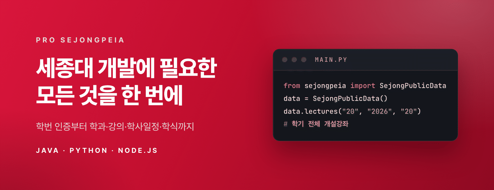
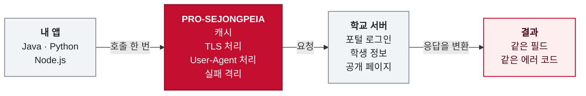
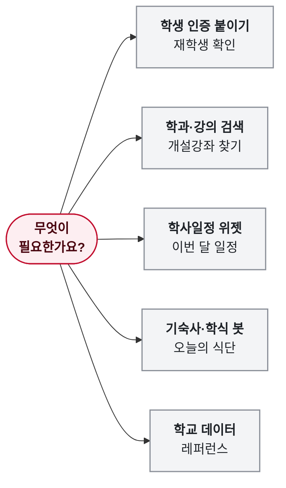

<div align="center">

<div align="right">

**한국어** · [English](README.en.md)

</div>




<br>

**학번 인증부터 학과·강의·학사일정·학식까지,<br>Java · Python · Node.js에서 호출 한 번으로.**

세종대에는 공식 API가 없어서, 직접 붙이면 포털 로그인과 학교 화면 파싱을 전부 풀어야 합니다.<br>그 부분을 이 라이브러리가 이미 풀어 두었습니다.

**[문서 사이트](https://cassiiopeia.github.io/pro-sejongpeia/)** &nbsp;·&nbsp; [브라우저에서 체험](https://cassiiopeia.github.io/pro-sejongpeia/#demo) &nbsp;·&nbsp; [빠른 시작](https://cassiiopeia.github.io/pro-sejongpeia/start/quickstart/) &nbsp;·&nbsp; [학교 데이터](https://cassiiopeia.github.io/pro-sejongpeia/data/overview/)

</div>

| | 직접 만들면 | pro-sejongpeia |
|---|---|---|
| **포털&nbsp;로그인** | 오래된 TLS 암호, 방화벽이 막는 User-Agent, 도메인 3곳의 SSO 쿠키를 직접 처리 | `authenticate(학번, 비밀번호)` 한 줄 |
| **로그인&nbsp;결과** | 실패해도 HTTP 200이라 응답 속 스크립트 값을 읽어 판정 | 첫 실패에서 멈추고 `AUTHENTICATION_FAILED` 같은 에러 코드로 구분 |
| **학교&nbsp;데이터** | 화면마다 다른 주소·HTML·JSON을 파싱하고 서버 부담도 직접 조절 | 같은 모양의 객체, 24시간 캐시, 실패하면 마지막 값 |
| **세&nbsp;언어** | 언어마다 따로 구현 | 같은 기능, 같은 결과 필드, 같은 에러 코드 |

<sub>각 항목이 어떻게 풀렸는지는 [이 라이브러리가 하는 일](https://cassiiopeia.github.io/pro-sejongpeia/start/introduction/)과 [이해하기](https://cassiiopeia.github.io/pro-sejongpeia/understand/legacy-tls/)에 있습니다.</sub>

```bash
pip install pro-sejongpeia      # Python 3.9+
npm install pro-sejongpeia      # Node 18+ (Java는 아래 바로 해 보기 참고)
```

<div align="center">

[](https://central.sonatype.com/artifact/kr.suhsaechan/sejongpeia) [](https://pypi.org/project/pro-sejongpeia/) [](https://www.npmjs.com/package/pro-sejongpeia) [](LICENSE) [](https://github.com/Cassiiopeia/pro-sejongpeia/actions/workflows/PROJECT-SEJONG-LIVE-CHECK.yml)

</div>

## 한눈에 보기

호출 한 번으로 캐시, TLS와 User-Agent 처리, 실패 격리를 거쳐 학교 서버의 응답이 같은 모양의 결과로 돌아옵니다.

<!-- diagram:overview:start -->

<!-- diagram:overview:end -->

## 무엇을 해 주나요

학번 인증 하나만 있는 라이브러리가 아닙니다. 학교가 로그인 없이 내려주는 정보도 같은 모양으로 받습니다. **전부 세 언어에서 똑같이** 지원하고, 이름 표기만 언어 관례(Python은 snake_case)를 따릅니다.

| | 기능 | 이런 걸 받아요 |
|:-:|---|---|
|  | **[학번 인증](https://cassiiopeia.github.io/pro-sejongpeia/auth/methods/)** | 학번과 포털 비밀번호로 재학생 확인. 이름·학과·학년·학적, 고전독서 인증 현황, 연락처. 통합 · DHC · SIS 중 골라 씁니다 |
|  | **[학과·학기 코드](https://cassiiopeia.github.io/pro-sejongpeia/data/codes/)** | 학부와 대학원 분류, 학기 목록, 학과 전체 목록 |
|  | **[개설강좌](https://cassiiopeia.github.io/pro-sejongpeia/data/lectures/)** | 학기 전체 또는 학과·과목명·교수명 검색. 시간표·강의실 포함 |
|  | **[교육과정·교과목 개요](https://cassiiopeia.github.io/pro-sejongpeia/data/curriculum/)** | 학과 교육과정의 권장 학년·학기, 학점, 교과목 개요 |
|  | **[학사일정](https://cassiiopeia.github.io/pro-sejongpeia/data/calendar/)** | 학부와 대학원 일정, 로그인으로 보는 업무별 허용 기간(수강신청·증명서 출력) |
|  | **[기숙사](https://cassiiopeia.github.io/pro-sejongpeia/data/dormitory/)** | 7일치 식단과 공지 |
|  | **[학식](https://cassiiopeia.github.io/pro-sejongpeia/data/cafeteria/)** | 식당 목록과 날짜별 메뉴·가격 |
|  | **[캠퍼스 장소](https://cassiiopeia.github.io/pro-sejongpeia/data/campus-places/)** | 건물·복지시설의 이름, 위치 좌표, 안내 |
|  | **[비교과 일정](https://cassiiopeia.github.io/pro-sejongpeia/data/extracurricular/)** | 비교과 프로그램 일정, 분류, 장소 |

## 어디서 시작할까요

필요한 것에 따라 읽을 문서를 고르세요.

<!-- diagram:choose:start -->

<!-- diagram:choose:end -->

[학생 인증 붙이기](https://cassiiopeia.github.io/pro-sejongpeia/guides/student-verification/) · [학과·강의 검색](https://cassiiopeia.github.io/pro-sejongpeia/guides/department-lecture-search/) · [학사일정 위젯](https://cassiiopeia.github.io/pro-sejongpeia/guides/academic-calendar/) · [기숙사·학식 봇](https://cassiiopeia.github.io/pro-sejongpeia/guides/dormitory-cafeteria-bot/) · [학교 데이터 레퍼런스](https://cassiiopeia.github.io/pro-sejongpeia/data/overview/). 모든 예시는 세 언어로 있습니다 ([통합 예시](docs/INTEGRATION_EXAMPLES.md)).

## 바로 해 보기

학번도 비밀번호도 필요 없습니다. 학과 목록과 소프트웨어학과(3220) 개설강좌를 받아 옵니다. 세 언어가 같은 호출, 같은 결과입니다.

**Python** · `pip install pro-sejongpeia`

```python
from sejongpeia import SejongPublicData

public_data = SejongPublicData()
departments = public_data.departments("20", "2026", "20")
lectures = public_data.lectures("20", "2026", "20", department_code="3220")
print(len(departments), lectures[0].name)
```

**Node.js** · `npm install pro-sejongpeia`

```js
import { SejongPublicData } from 'pro-sejongpeia';

const publicData = new SejongPublicData();
const term = { categoryCode: '20', year: '2026', semesterCode: '20' };
const departments = await publicData.departments(term);
const lectures = await publicData.lectures({ ...term, departmentCode: '3220' });
console.log(departments.length, lectures[0].name);
```

**Java / Spring Boot** · `implementation "kr.suhsaechan:sejongpeia:<버전>"` ([최신 버전 확인](https://central.sonatype.com/artifact/kr.suhsaechan/sejongpeia), Java 17+, Maven Central)

```java
SejongPublicData publicData = new SejongPublicData();   // Spring에서는 빈으로 주입
List<Department> departments = publicData.departments("20", "2026", "20");
List<Lecture> lectures = publicData.lectures("20", "2026", "20", "3220", "", "");
System.out.println(departments.size() + " " + lectures.get(0).getName());
```

예시 출력입니다 (Python, 학교 서버 3번 호출에 0.3초).

<p align="center">
  
</p>

### 학번 인증도 한 줄

```python
result = authenticate("21011234", "비밀번호")             # Python
print(result.name, result.major, result.grade)
```

```js
const result = await authenticate('21011234', '비밀번호');   // Node.js
console.log(result.name, result.major, result.grade);
```

```java
SejongAuthResult result = sejongAuthEngine.authenticate(studentId, password);   // Java, Spring Boot 빈
System.out.println(result.getName() + " " + result.getMajor() + " " + result.getGrade());
```

> [!WARNING]
> 포털은 비밀번호를 여러 번 틀리면 계정을 잠급니다. 라이브러리는 거부된 로그인을 재시도하지 않지만, 누구나 학번을 입력할 수 있는 서비스라면 **학번별 실패 횟수를 직접 제한**하세요. 잠긴 계정은 [포털에서 비밀번호를 재설정](https://portal.sejong.ac.kr/jsp/inquiry/pwinquiry.jsp)해야 풀립니다.

학번 인증은 브라우저에서 먼저 해 볼 수도 있습니다.

<p align="center">
  <a href="https://cassiiopeia.github.io/pro-sejongpeia/#demo">
    
  </a>
  <br>
  <sub>소개 페이지의 실시간 데모 (눌러서 체험). 실제 인증 결과이며 개인정보 칸만 예시값으로 바꿨습니다.</sub>
</p>

에러 처리, Spring 설정, 일반 Java 사용법은 [빠른 시작 페이지](https://cassiiopeia.github.io/pro-sejongpeia/start/quickstart/)에 세 언어 탭으로 있습니다.

## 왜 이 라이브러리인가

약속마다 코드나 테스트로 확인할 수 있는 근거가 있습니다.

| 약속 | 근거 | 자세히 |
|---|---|---|
|  **빠르고&nbsp;가볍게** | 의존성 0개 (Python, Node). 학과 목록과 한 학과 강좌는 0.1초 안팎, 통합 인증은 로그인 한 번으로 0.6~0.8초 (5회 중앙값) | [하는 일](https://cassiiopeia.github.io/pro-sejongpeia/start/introduction/) |
|  **요청은&nbsp;아끼고** | 24시간 캐시, 같은 인자의 동시 호출은 요청 1번, 실패는 60초간 기억 | [캐시와 실패 격리](https://cassiiopeia.github.io/pro-sejongpeia/understand/failure-isolation-cache/) |
|  **안전하게** | 비밀번호는 저장하지 않고 오류 메시지에도 담지 않음. SIS 부가 필드에서 세션값·접속 IP·주민번호·계좌 등은 항상 제외 | [로그인 판정](https://cassiiopeia.github.io/pro-sejongpeia/understand/login-verdict/) |
|  **믿을&nbsp;수&nbsp;있게** | 매일 09:00(KST) 실제 포털 로그인 점검, 세 언어 공통 값은 [spec/contract.json](spec/contract.json) 한 곳 | [매일 점검](https://cassiiopeia.github.io/pro-sejongpeia/understand/daily-live-check/) |

## 이럴 땐 맞지 않습니다

> [!IMPORTANT]
> 아래 중 하나라도 해당하면 도입 전에 읽어 보세요.

- **학교가 보증하는 API가 필요할 때.** 문서로 공개된 API가 아니라 학교 웹 화면이 쓰는 비공식 주소를 따라갑니다. 학교가 바꾸면 멈출 수 있고, 매일 점검해 깨지면 이슈로 고치지만 수정 시점은 약속하지 않습니다.
- **하위 호환이 필요할 때.** 같은 `1.x` 안에서도 깨지는 변경이 있을 수 있으니 버전을 고정하세요 ([API 안정성](docs/API_STABILITY.md)).
- **브라우저나 앱에서 직접 부르고 싶을 때.** 비밀번호가 제3자 코드에 노출되므로 서버에서만 호출하세요.
- **실시간 값이 꼭 필요할 때.** 공개 데이터는 기본 24시간 캐시입니다. 학교 쪽이 실패하면 예외 대신 마지막 값이나 빈 목록을 돌려주므로, 빈 목록이 「데이터 없음」인지 「학교 쪽 문제」인지는 구분하지 못합니다.
- **학교 값을 가공해 받고 싶을 때.** 학교가 준 문자열 그대로이고 코드표나 이름 매핑이 없습니다.

세종대학교의 공식 라이브러리가 아닙니다. 세종대 학생이 만든 개인 오픈소스이며 학교와 제휴 관계가 없습니다.

## 더 알아보기

세부 내용은 문서 사이트에 있고, 여기서는 반복하지 않습니다.

| 궁금한 것 | 어디에 있나요 |
|---|---|
| 설치부터 첫 호출, Spring 설정 | [빠른 시작](https://cassiiopeia.github.io/pro-sejongpeia/start/quickstart/) |
| 인증 메서드, 결과 필드, 에러 코드, 설정 | [인증 레퍼런스](https://cassiiopeia.github.io/pro-sejongpeia/auth/methods/) ([결과 필드](https://cassiiopeia.github.io/pro-sejongpeia/auth/result-fields/), [에러 코드](https://cassiiopeia.github.io/pro-sejongpeia/auth/error-codes/), [설정](https://cassiiopeia.github.io/pro-sejongpeia/auth/configuration/)) |
| 메서드별 요청과 응답 구조 | [학교 데이터 레퍼런스](https://cassiiopeia.github.io/pro-sejongpeia/data/overview/) |
| 포털이 어떻게 막는지, 우리가 어떻게 풀었는지 | [이해하기](https://cassiiopeia.github.io/pro-sejongpeia/understand/legacy-tls/) ([SSO 흐름](https://cassiiopeia.github.io/pro-sejongpeia/understand/sso-flow/)), 로그인 흐름은 [DHC](docs/DHC_LOGIN_FLOW.md)·[SIS](docs/SIS_LOGIN_FLOW.md) |
| 계약과 결과 스키마 | [spec/PUBLIC_DATA.md](spec/PUBLIC_DATA.md), [spec/RESULT_SCHEMA.md](spec/RESULT_SCHEMA.md), [spec/PORTAL_FLOW.md](spec/PORTAL_FLOW.md) |
| 통합 예시, API 안정성 | [통합 예시](docs/INTEGRATION_EXAMPLES.md), [API 안정성 정책](docs/API_STABILITY.md) |
| 코딩 에이전트와 함께 쓰기 | [에이전트 가이드](https://cassiiopeia.github.io/pro-sejongpeia/guides/agents/) ([llms.txt](https://cassiiopeia.github.io/pro-sejongpeia/llms.txt), [api.json](https://cassiiopeia.github.io/pro-sejongpeia/api.json)), 기여하는 에이전트는 [AGENTS.md](AGENTS.md) |

## FAQ

<details>
<summary><b>인증이 갑자기 실패해요 / 포털 계정이 잠겼어요</b></summary>

[데모](https://cassiiopeia.github.io/pro-sejongpeia/#demo)로 먼저 확인해 보세요. 데모도 실패하면 포털 쪽이 바뀌었을 가능성이 높으니 [이슈](https://github.com/Cassiiopeia/pro-sejongpeia/issues)에 에러 코드와 함께 남겨 주세요.
`ACCOUNT_LOCKED`는 포털이 계정을 잠근 것으로, <https://portal.sejong.ac.kr/jsp/inquiry/pwinquiry.jsp> 에서 본인 확인 후 비밀번호를 재설정해야 합니다. 기다린다고 풀리지 않습니다.
</details>

더 많은 질문은 [사이트 FAQ](https://cassiiopeia.github.io/pro-sejongpeia/faq/)에 있습니다.

## 기여하기

버그 제보, 포털 변경 대응, 문서 개선 모두 환영합니다. 포털이 바뀌면 세 언어를 한 PR에서 같이 고칩니다. [CONTRIBUTING.md](CONTRIBUTING.md)를 보세요. 새 학교 정보 출처는 [새 출처 추가하기](https://cassiiopeia.github.io/pro-sejongpeia/contribute/add-data-source/), 구조는 [레포 구조](https://cassiiopeia.github.io/pro-sejongpeia/contribute/structure/), 이슈·PR은 [이슈와 PR](https://cassiiopeia.github.io/pro-sejongpeia/contribute/issues-and-prs/)를 참고하세요.
보안 문제는 [SECURITY.md](SECURITY.md)의 비공개 신고를 이용해 주세요.

이 라이브러리로 시간을 아꼈다면 GitHub Star 하나가 다른 세종대 개발자들이 찾는 데 도움이 됩니다.

<!-- AUTO-VERSION-SECTION: DO NOT EDIT MANUALLY -->
## 최신 버전 : v1.2.72

[전체 변경 이력](CHANGELOG.md)

## 라이선스

[MIT](LICENSE) © 2025 Suh Saechan

---

<sub>이 프로젝트는 세종대학교의 공식 제품이 아니며 세종대학교와 제휴 관계가 없습니다. 세종대학교 교표의 권리는 세종대학교에 있습니다.</sub>
