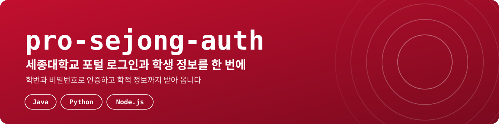
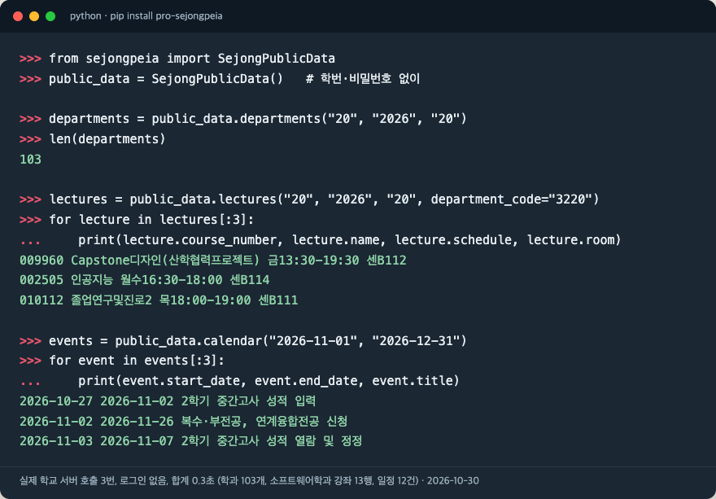

<div align="center">




# pro-sejongpeia

**Pro Sejongpeia: 세종대 개발자들의 작은 유토피아.**
학번 인증부터 학과·강의·학사일정·학식까지, Java·Python·Node.js에서 호출 한 번으로.

<sub>세종대 로그인 API · 세종대학교 포털 인증 · 학번 인증 · 학교 데이터 라이브러리 (Java · Python · Node)</sub>

[사이트](https://cassiiopeia.github.io/pro-sejongpeia/) · [브라우저에서 체험](https://cassiiopeia.github.io/pro-sejongpeia/#demo) · [빠른 시작](#빠른-시작-java--spring-boot) · [기능](#기능) · [문서](#더-보기-통합-예시와-api-안정성) · 한국어 | [English](README.en.md)

<!-- AUTO-VERSION-SECTION: DO NOT EDIT MANUALLY -->
## 최신 버전 : v1.2.49 (2026-10-29)

[](https://central.sonatype.com/artifact/kr.suhsaechan/sejongpeia)
[](https://pypi.org/project/pro-sejongpeia/)
[](https://www.npmjs.com/package/pro-sejongpeia)
[](LICENSE)
[](https://github.com/Cassiiopeia/pro-sejongpeia/actions/workflows/PROJECT-SEJONG-LIVE-CHECK.yml)

</div>

---

## 바로 해 보기

학번도 비밀번호도 필요 없습니다. 2026학년도 2학기 학과 목록과 소프트웨어학과(3220) 개설강좌를 받아 옵니다. 세 언어가 같은 호출, 같은 결과입니다.

**Python** · `pip install pro-sejongpeia`

```python
from sejongpeia import SejongPublicData

public_data = SejongPublicData()
departments = public_data.departments("20", "2026", "20")
lectures = public_data.lectures("20", "2026", "20", department_code="3220")
print(len(departments), lectures[0].name)
```

**Node.js** · `npm install pro-sejongpeia`

```js
import { SejongPublicData } from 'pro-sejongpeia';

const publicData = new SejongPublicData();
const departments = await publicData.departments({ categoryCode: '20', year: '2026', semesterCode: '20' });
const lectures = await publicData.lectures({ categoryCode: '20', year: '2026', semesterCode: '20', departmentCode: '3220' });
console.log(departments.length, lectures[0].name);
```

**Java / Spring Boot** · `implementation "kr.suhsaechan:sejongpeia:<버전>"`

```java
SejongPublicData publicData = new SejongPublicData();   // Spring에서는 빈으로 주입
List<Department> departments = publicData.departments("20", "2026", "20");
List<Lecture> lectures = publicData.lectures("20", "2026", "20", "3220", "", "");
System.out.println(departments.size() + " " + lectures.get(0).getName());
```

실제로 돌린 결과입니다 (Python, 2026-10-30, 학교 서버 3번 호출에 0.3초).

<p align="center">
  
</p>

학번 인증은 브라우저에서 먼저 해 볼 수 있습니다. 코드는 [빠른 시작](#빠른-시작-java--spring-boot)에 있습니다.

<p align="center">
  <a href="https://cassiiopeia.github.io/pro-sejongpeia/#demo">
    
  </a>
  <br>
  <sub>소개 페이지의 실시간 데모 (▶ 눌러서 체험). 실제 인증 결과이며 개인정보 칸만 예시값으로 바꿨습니다.</sub>
</p>

## 기능

**전부 세 언어에서 똑같이 지원합니다.** 같은 기능, 같은 결과 모양, 이름 표기만 언어 관례(Python은 snake_case)를 따릅니다.

| 기능 | Java | Python | Node |
|---|---|---|---|
| **로그인 (학번 + 포털 비밀번호)** | | | |
| 통합 인증: 학생 정보 + 고전독서 + 연락처 (포털 로그인 1번) | ✅ `authenticate` | ✅ `authenticate` | ✅ `authenticate` |
| DHC 인증: 학생 정보 + 고전독서 인증 현황 | ✅ `authenticateWithDHC` | ✅ `authenticate_dhc` | ✅ `authenticateDhc` |
| SIS 인증: 학생 정보 + 이메일, 전화번호, 영문 이름 | ✅ `authenticateWithSIS` | ✅ `authenticate_sis` | ✅ `authenticateSis` |
| SIS 사용자 코드 (학과 코드 등 11개) + 나머지 필드 `extra` | ✅ `authenticate(id, pw, false, true)` | ✅ `include_extra=True` | ✅ `{ includeExtra: true }` |
| 원본 응답 포함 (디버깅) | ✅ `authenticateWithRaw` 외 | ✅ `include_raw=True` | ✅ `{ includeRaw: true }` |
| SIS 학사 업무 기간 (수강신청·증명서 출력 등 업무별 허용 기간) | ✅ `fetchSisBusinessPeriods` | ✅ `fetch_sis_business_periods` | ✅ `fetchSisBusinessPeriods` |
| **로그인 없이 (학교 공개 데이터)** | | | |
| 단과대·학과 코드, 학기 (소속 분류별) | ✅ `departments` 외 | ✅ `departments` 외 | ✅ `departments` 외 |
| 개설강좌, 학기 전체 (학과·과목명·교수명 검색) | ✅ `lectures` | ✅ `lectures` | ✅ `lectures` |
| 교육과정 과목과 교과목 개요 (권장 학년·학기, 학점) | ✅ `curriculumCourses` | ✅ `curriculum_courses` | ✅ `curriculumCourses` |
| 학사일정: 학부 + 대학원 | ✅ `calendar`, `graduateCalendar` | ✅ `calendar`, `graduate_calendar` | ✅ `calendar`, `graduateCalendar` |
| 기숙사 식단·공지 | ✅ `dormitoryMenu`, `dormitoryNotices` | ✅ `dormitory_menu`, `dormitory_notices` | ✅ `dormitoryMenu`, `dormitoryNotices` |
| 학식 식당 목록·메뉴 | ✅ `cafeteriaPlaces`, `cafeteriaMenu` | ✅ `cafeteria_places`, `cafeteria_menu` | ✅ `cafeteriaPlaces`, `cafeteriaMenu` |
| 캠퍼스 장소 | ✅ `campusPlaces` | ✅ `campus_places` | ✅ `campusPlaces` |
| 비교과 프로그램 일정 | ✅ `extracurricularEvents` | ✅ `extracurricular_events` | ✅ `extracurricularEvents` |

- 학과 분류·학기·학과는 `organizationCategories`, `terms`, `departments`, 개설강좌 보조 코드는 `courseTypes`, `selectiveDomains`입니다 (Python은 `organization_categories`, `course_types`, `selective_domains`). 공개 데이터 계약은 [spec/PUBLIC_DATA.md](spec/PUBLIC_DATA.md)입니다.
- 원본 응답 옵션은 Java에서 `authenticateWithRaw`, `authenticateWithDHCRaw`, `authenticateWithSISRaw`입니다.
- **언어 간 같은 결과**는 공통 값을 [spec/contract.json](spec/contract.json) 한 곳에 두고, 어긋나면 언어별 테스트가 실패하게 해서 지킵니다.
- 통합 인증은 포털에 **한 번만** 로그인하고 같은 세션으로 DHC와 SIS를 조회합니다. SIS(연락처) 조회가 실패해도 학생 정보는 돌려주고 연락처 칸만 null입니다. 실측 시간(2026-10-24, 서울, 5회 중앙값)은 Java 0.57초, Python 0.76초, Node 0.69초이고 대부분 포털 응답 시간입니다.
- SIS 학사 업무 기간은 공개 학사일정(`calendar`)과 다른 자료입니다. 본인 SIS의 "학사일정조회" 화면이 주는 업무별 허용 기간(`period`, `scheduleName`, `businessName`, `target`, `timeText` 등, 학교 원문)이고, 연도와 월(비우면 연간 전체)로 조회합니다. 학교가 형태가 틀린 요청에 세션을 끊기 때문에 브라우저와 같은 순서로만 요청하고, 실패하면 재시도 없이 멈춥니다. 학부생 계정 1개로 확인했고 다른 신분은 확인하지 못했습니다. 흐름은 [spec/PORTAL_FLOW.md](spec/PORTAL_FLOW.md)의 2d입니다.

| 로그인 데이터 소스 | 도메인 | 제공 정보 |
|---|---|---|
| **DHC** (대양휴머니티칼리지) | classic.sejong.ac.kr | 학생 정보 + 고전독서 인증 현황 |
| **SIS** (학사정보시스템) | sjpt.sejong.ac.kr | 학생 정보 + 이메일, 전화번호, 영문 이름 |

## 왜 이 라이브러리인가

직접 붙이려면 만나게 되는 어려운 부분을 미리 풀어 두었습니다.

| 직접 구현하면 | 이 라이브러리 |
|---|---|
| 최신 JDK·OpenSSL 기본 설정이 막는, 포털이 유일하게 허용하는 암호(`TLS_RSA_WITH_AES_256_CBC_SHA`)를 언어마다 다르게 풀기 | Java(JVM 설정), Python, Node 모두 처리, Spring Boot는 시작할 때 자동 적용 |
| 기본 라이브러리 User-Agent를 방화벽이 막고, 없으면 일부 사이트가 404를 돌려줌 | 식별 가능한 User-Agent를 자동으로 보냄 |
| 포털 로그인 폼, SSO 리다이렉트, 세종대 도메인 3곳의 세션 쿠키 | 호출마다 처리하고 따로 저장할 것 없음 ([spec/PORTAL_FLOW.md](spec/PORTAL_FLOW.md)) |
| 200 응답 속 판정(비밀번호 오류, 계정 잠금)을 직접 판별, 틀린 비밀번호 재시도로 계정이 잠김 | `AUTHENTICATION_FAILED` / `ACCOUNT_LOCKED`로 첫 실패에서 즉시 멈춤 |
| HTML 표(DHC)와 JSON API(SIS) 파싱, 학생 정보와 연락처에 로그인 두 번 | 정리된 결과 객체, 호출 한 번에 포털 로그인 한 번 |
| 학교 서버 하나가 실패하면 앱 전체가 흔들림 | 공개 데이터는 마지막 캐시 값이나 빈 목록으로 대응, 24시간 메모리 캐시 |
| 포털이 바뀐 걸 사용자 불만으로 알게 됨 | 매일 워크플로우가 세 언어로 실제 포털에 로그인하고, 실패하면 이슈를 엶 |
| 세 언어 구현을 손으로 맞춤 | 공통 값은 [spec/contract.json](spec/contract.json) 한 곳, 어긋나면 테스트가 실패 |

Python·Node는 **외부 의존성이 0개**입니다.

## 이런 곳에 씁니다

- 동아리·학생회·학내 커뮤니티 가입 시 **세종대 학생 인증**
- 학과·학년 조건이 있는 학내 이벤트 참여 확인, 고전독서 인증 현황을 보여 주는 학습 도우미
- 학과·강의 검색, 학사일정 위젯, 기숙사·학식 봇 ([통합 예시](docs/INTEGRATION_EXAMPLES.md))

## 빠른 시작: Java / Spring Boot

**Maven Central**에서 배포합니다 (저장소 추가 불필요). Java 17+, Spring Boot 3.x.

```groovy
dependencies {
    implementation "kr.suhsaechan:sejongpeia:<버전>"   // Maven Central 배지 확인
}
```

<details>
<summary>Maven</summary>

```xml
<dependency>
    <groupId>kr.suhsaechan</groupId>
    <artifactId>sejongpeia</artifactId>
    <version><!-- Maven Central 배지 확인 --></version>
</dependency>
```

</details>

Spring Boot 자동 설정이 `SuhSejongAuthEngine` 빈을 등록합니다.

```java
import kr.suhsaechan.sejongpeia.auth.model.SejongAuthResult;
import kr.suhsaechan.sejongpeia.auth.service.SuhSejongAuthEngine;

@RestController
@RequiredArgsConstructor
public class AuthController {

    private final SuhSejongAuthEngine sejongAuthEngine;

    @PostMapping("/auth/sejong")
    public SejongAuthResult authenticate(@RequestParam String studentId,
                                         @RequestParam String password) {
        return sejongAuthEngine.authenticate(studentId, password);
    }
}
```

<details>
<summary>Spring 없이 쓰기 (일반 Java)</summary>

Spring Boot는 선택 의존성이라 일반 Java 프로젝트는 받지 않습니다.

```java
import kr.suhsaechan.sejongpeia.auth.client.SejongPortalClient;
import kr.suhsaechan.sejongpeia.auth.client.SejongSisClient;
import kr.suhsaechan.sejongpeia.auth.model.SejongAuthResult;
import kr.suhsaechan.sejongpeia.auth.parser.SejongClassicReadingParser;
import kr.suhsaechan.sejongpeia.auth.parser.SejongSisParser;
import kr.suhsaechan.sejongpeia.auth.parser.SejongStudentInfoParser;
import kr.suhsaechan.sejongpeia.auth.service.SuhSejongAuthEngine;
import kr.suhsaechan.sejongpeia.common.config.SejongAuthProperties;
import kr.suhsaechan.sejongpeia.common.util.SejongTlsSupport;

SejongTlsSupport.ensureLegacyCipherEnabled();   // main() 맨 앞, 다른 HTTPS 호출보다 먼저 (TLS 안내 참고)
SejongAuthProperties properties = new SejongAuthProperties();
SuhSejongAuthEngine engine = new SuhSejongAuthEngine(new SejongPortalClient(properties), new SejongStudentInfoParser(),
    new SejongClassicReadingParser(), new SejongSisClient(properties), new SejongSisParser());
SejongAuthResult result = engine.authenticate(studentId, password);
```

</details>

**고전독서 인증 확인 (Java)**

```java
SejongDhcAuthResult result = sejongAuthEngine.authenticateWithDHC(studentId, password);

for (ClassicCertification certification : result.getClassicReading().getCertifications()) {
    System.out.println(certification.getArea() + " "
        + certification.getCertifiedCount() + "/" + certification.getRequiredCount());
}
```

## 빠른 시작: Python

Python 3.9+, 표준 라이브러리 외 의존성 없음.

```bash
pip install pro-sejongpeia
```

```python
from sejongpeia import authenticate, SejongAuthError, ErrorCode

try:
    result = authenticate("21011234", "비밀번호")
    print(result.name, result.major, result.grade)
except SejongAuthError as error:
    if error.code == ErrorCode.AUTHENTICATION_FAILED:
        print("학번 또는 비밀번호가 틀렸습니다")
    elif error.code == ErrorCode.ACCOUNT_LOCKED:
        print("포털 계정이 잠겼습니다. 포털에서 비밀번호를 재설정하세요")
```

## 빠른 시작: Node.js

Node 18+, 의존성 0개, TypeScript 타입 포함, ESM·CommonJS 모두 지원. 서버 전용입니다.

```bash
npm install pro-sejongpeia
```

```js
import { authenticate, SejongAuthError, ErrorCode } from 'pro-sejongpeia';

try {
  const result = await authenticate('21011234', '비밀번호');
  console.log(result.name, result.major, result.grade);
} catch (error) {
  if (error instanceof SejongAuthError && error.code === ErrorCode.AUTHENTICATION_FAILED) {
    console.log('학번 또는 비밀번호가 틀렸습니다');
  } else if (error instanceof SejongAuthError && error.code === ErrorCode.ACCOUNT_LOCKED) {
    console.log('포털 계정이 잠겼습니다. 포털에서 비밀번호를 재설정하세요');
  }
}
```

## 로그인 없이 쓰는 학교 데이터

학번·비밀번호 없이 학교가 공개로 내려주는 정보를 같은 모양으로 받습니다. 메서드 목록은 위 [기능](#기능) 표를, 첫 호출은 [바로 해 보기](#바로-해-보기)를 보세요. 강의에서 교육과정으로 이어 가는 예시입니다 (Node·Java는 같은 이름의 camelCase 메서드).

```python
from sejongpeia import SejongPublicData

public_data = SejongPublicData()
departments = public_data.departments("20", "2026", "20")          # 학부, 2026년 2학기
lectures = public_data.lectures("20", "2026", "20", department_code=departments[0].code)
# 강의의 과목 번호로 그 학과 교육과정의 학년·학기·교과목 개요 (없으면 빈 목록)
courses = public_data.curriculum_courses(lectures[0].department_code, lectures[0].course_number)
```

- **학교 값을 그대로** 돌려줍니다. 코드표나 이름 매핑을 라이브러리에 박아 두지 않아서 학과가 바뀌어도 코드를 고칠 필요가 없습니다. 쓰지 않은 학교 필드는 `extra`에 담깁니다.
- **한 곳이 실패해도 나머지는 그대로**입니다. 실패하면 마지막 캐시 값이나 빈 목록을 돌려주고 예외를 던지지 않습니다 (잘못된 입력값만 예외).
- 결과를 메모리에 24시간 캐시하고, 같은 요청은 한 번만 보냅니다. 학교 서버에 부담을 주지 않도록 쓰세요.
- 학식 `cafeteria_places`가 식당 번호·이름·건물·위치 목록을 줍니다. 학교에 식당 목록 API가 없어 번호 1~10의 메뉴 응답에서 모은 목록이라, 그날 메뉴가 비어 있는 식당은 빠질 수 있고 한 번 갱신에 최대 10건을 순서대로 요청합니다 (결과는 24시간 캐시). 식사 구분 `meal_type_id`는 1이 중식, 2가 석식이며 고정 메뉴 식당은 비어 있습니다. 자세한 내용은 [spec/PUBLIC_DATA.md](spec/PUBLIC_DATA.md)입니다.
- 개설강좌 조회는 학교가 모든 필터 키를 요구하는 등 직접 맞추기 까다로운 부분을 라이브러리가 처리합니다. 학과·과목명·교수명을 모두 비우면 그 학기 전체를 한 번에 받습니다 (학부 2026/2학기 약 2,800행, 응답 2.4MB이므로 가능하면 학과 단위로 조회하세요).

## 결과 필드

<details>
<summary>전체 결과 필드 펼치기</summary>

아래 이름은 Java·Node 기준입니다. Python은 snake_case(`student_id`, `phone_number` 등)를 씁니다. 전체 스키마: [spec/RESULT_SCHEMA.md](spec/RESULT_SCHEMA.md)

| 필드 | 타입 | 설명 |
|---|---|---|
| `success` | boolean | 인증 성공 여부 |
| `studentId` | string | 학번 |
| `name` | string | 이름 |
| `major` | string | 학과(전공) |
| `grade` | string | 학년 |
| `status` | string | 학적 상태 (재학, 휴학, 졸업) |
| `classicReading` | object | 고전독서 인증 현황, 시험·대회·대체 이수 기록, `completedSemesters`(이수 학기)·`certifiedSemesters`(인증완료 학기)·`certificationStatus`(인증여부) 포털 원문 |
| `email` | string 또는 null | 이메일 (SIS 실패 시 null) |
| `phoneNumber` | string 또는 null | 전화번호, `010-1234-5678` 형식 (SIS 실패 시 null) |
| `englishName` | string 또는 null | 영문 이름 (SIS 실패 시 null) |
| `userCategory` | string 또는 null | 사용자 구분, 예: `학부생` (SIS 실패 시 null) |
| `parentUnitName` | string 또는 null | 학과의 상위 소속 이름(단과대학 또는 학부), 포털 메인 화면 표기에서 추출 (호출 실패 시 null, 값이 없으면 빈 문자열). 학년도마다 바뀌는 포털 표기 원문이라 값 목록으로 분기하거나 인증 판정에 쓰지 마세요 |
| `authenticatedAt` | 날짜·시간 | 인증 시각 |
| `departmentCode` 외 코드 10개 | string 또는 null | SIS 학교 제공 코드 원문: `departmentCode`(학과 코드), `organizationClassificationCode`, `enrollmentStatusCode`, `userClassificationCode`·`LargeCode`·`MiddleCode`, `roleCode`, `roleName`, `menuSystemId`, `menuSystemName`, `locale` (SIS 실패 시 null, 없으면 빈 문자열). 코드 이름 매핑은 라이브러리에 없음 |
| `extra` | 맵 또는 null | 옵션을 켰을 때만: 이름 붙이지 않은 나머지 SIS 필드 `{"데이터셋.필드": 원문}`. 세션값, 접속 IP, 비밀번호·계정 상태, 주민번호, 계좌, 주소, 직원 이름 등 민감 키는 항상 제외되지만 이름 패턴 기준이라 외부 클라이언트에 그대로 내려주지 마세요 |
| `rawHtml` | string 또는 null | DHC 원문 HTML (원본 옵션일 때만) |
| `rawJson` | string 또는 null | SIS 원문 JSON (원본 옵션일 때만, SIS 실패 시 null) |

- 원본 옵션은 추가 요청 없이 이미 받은 응답만 담습니다. SIS 원문에는 세션 식별자로 보이는 값, 접속 IP, 접속 시각이 들어 있으니 외부 클라이언트에 그대로 내려주지 마세요. 원문의 키와 구조는 학교가 바꾸면 달라질 수 있어 호환성 보장 범위 밖입니다.
- DHC 결과: 연락처 필드 없음, 원본 옵션 사용 시 `rawHtml` 포함
- SIS 결과: `userCategory` 포함, 고전독서 필드 없음, `grade`·`status`는 빈 문자열, 원본 옵션 사용 시 `rawJson` 포함

</details>

## 에러 코드

모든 언어가 `code`를 가진 에러 하나를 던집니다.

| 코드 | 의미 |
|---|---|
| `AUTHENTICATION_FAILED` | 학번 또는 비밀번호가 일치하지 않음 |
| `ACCOUNT_LOCKED` | 비밀번호를 여러 번 틀려 포털이 계정을 잠금 |
| `ACCOUNT_UNAVAILABLE` | 포털 계정으로 로그인할 수 없음 (사용 기간 종료 또는 관리자 차단) |
| `INVALID_INPUT` | 입력값이 비었음 (네트워크 호출 전에 확인) |
| `CONNECTION_FAILED` | 세종대 포털에 연결할 수 없음 |
| `CONNECTION_TIMEOUT` | 포털 응답 시간 초과 |
| `DATA_FETCH_FAILED` | 학생 정보 조회 실패 |
| `PARSE_ERROR` | 포털 응답 구조 변경 등으로 파싱 실패 |
| `SESSION_ERROR` | 포털 세션 처리 오류 |
| `SSL_CONFIGURATION_ERROR` | SSL 설정 오류 |

분기는 메시지가 아니라 코드로 하세요.

> **계정 잠금.** 세종대 포털은 비밀번호를 여러 번 틀리면(포털 안내상 약 5회) 계정을 잠급니다. 잠금은 <https://portal.sejong.ac.kr/jsp/inquiry/pwinquiry.jsp> 에서 비밀번호를 재설정해야 풀리며, 라이브러리가 대신 풀 수 없습니다. 라이브러리는 거부된 로그인을 재시도하지 않고, 첫 실패에서 추가 요청 없이 멈춥니다. 누구나 학번을 입력할 수 있는 서비스라면 학번별 실패 횟수를 제한해 남이 다른 학생의 계정을 잠그지 못하게 하세요.

## 설정

모두 선택 항목입니다. 기본값: 제한 시간 10초, 로그인 재시도 3회, 인증서 검증 켬.

| Java (`application.yml`) | Python | Node |
|---|---|---|
| `sejongpeia.timeout-seconds: 10` | `SejongAuthClient(timeout_seconds=10)` | `new SejongAuthClient({ timeoutSeconds: 10 })` |
| `sejongpeia.max-retry: 3` | `max_retry=3` | `maxRetry: 3` |
| `sejongpeia.ssl-verification: true` | `ssl_verification=True` | `sslVerification: true` |

> **Java TLS 안내**: 세종 포털은 최신 JDK가 막아 둔 레거시 cipher(`TLS_RSA_WITH_AES_256_CBC_SHA`)만 제공합니다. Java 라이브러리는 `jdk.tls.disabledAlgorithms`에서 `TLS_RSA_*`를 빼는데, 이 설정은 **JVM 전체**에 적용되고 JVM의 첫 TLS 연결 전에만 효과가 있습니다. Spring Boot는 시작할 때 자동으로 처리합니다. Spring 없이 쓰면 `main()` 맨 앞에서 `SejongTlsSupport.ensureLegacyCipherEnabled()`를 부르세요. 늦게 부르면 인증이 `CONNECTION_FAILED`와 그 원인을 알리는 메시지로 실패합니다. JVM 전체 변경을 허용할 수 없다면 인증을 별도 프로세스로 분리하세요. Python·Node는 자기 연결의 TLS 설정만 바꿉니다.

포털 흐름 설명: [spec/PORTAL_FLOW.md](spec/PORTAL_FLOW.md), [DHC 로그인 플로우](docs/DHC_LOGIN_FLOW.md), [SIS 로그인 플로우](docs/SIS_LOGIN_FLOW.md)

## 더 보기: 통합 예시와 API 안정성

- [통합 예시](docs/INTEGRATION_EXAMPLES.md): 학생 인증(동아리 가입), 학과·강의 검색, 학사일정 위젯, 기숙사·학식 봇을 Java, Python, Node로. 공개 데이터 예시는 실제 학교 서버로 실행해 확인했습니다.
- [API 안정성 정책](docs/API_STABILITY.md): 공개 API와 내부 구현의 경계, 버전 규칙. **하위 호환은 보장하지 않으니 버전을 고정해서 쓰세요.**

## FAQ

<details>
<summary><b>비밀번호를 저장하나요?</b></summary>

라이브러리는 비밀번호를 저장하지 않고 포털 로그인 요청에만 씁니다. 소개 페이지의 데모 서버도 결과만 돌려주고 입력값을 저장하지 않습니다.
여러분의 서비스에서도 비밀번호를 로그나 DB에 남기지 않도록 주의하세요.
</details>

<details>
<summary><b>세종대학교 공식 라이브러리인가요?</b></summary>

아닙니다. 세종대 학생이 만든 개인 오픈소스이며 학교와 제휴 관계가 없습니다.
</details>

<details>
<summary><b>인증이 갑자기 실패해요</b></summary>

[데모](https://cassiiopeia.github.io/pro-sejongpeia/#demo)로 먼저 확인해 보세요. 데모도 실패하면 포털 쪽이 바뀌었을 가능성이 높습니다.
[이슈](https://github.com/Cassiiopeia/pro-sejongpeia/issues)에 에러 코드와 함께 남겨 주세요.
</details>

<details>
<summary><b>포털 계정이 잠겼어요</b></summary>

비밀번호를 여러 번 틀리면 포털이 계정을 잠그고, 라이브러리는 `ACCOUNT_LOCKED`를 돌려줍니다. <https://portal.sejong.ac.kr/jsp/inquiry/pwinquiry.jsp> 에서 본인 확인 후 비밀번호를 재설정하세요. 기다린다고 풀리지 않습니다.
</details>

## 기여하기

버그 제보, 포털 변경 대응, 문서 개선 모두 환영합니다. 포털이 바뀌면 세 언어를 한 PR에서 같이 고칩니다. [CONTRIBUTING.md](CONTRIBUTING.md)를 보세요.
보안 문제는 [SECURITY.md](SECURITY.md)의 비공개 신고를 이용해 주세요.

이 라이브러리로 시간을 아꼈다면 ⭐ 하나가 다른 세종대 개발자들이 찾는 데 도움이 됩니다.

## 라이선스

[MIT](LICENSE) © 2025 Suh Saechan

---

<sub>이 프로젝트는 세종대학교의 공식 제품이 아니며 세종대학교와 제휴 관계가 없습니다. 세종대학교 교표의 권리는 세종대학교에 있습니다.</sub>
